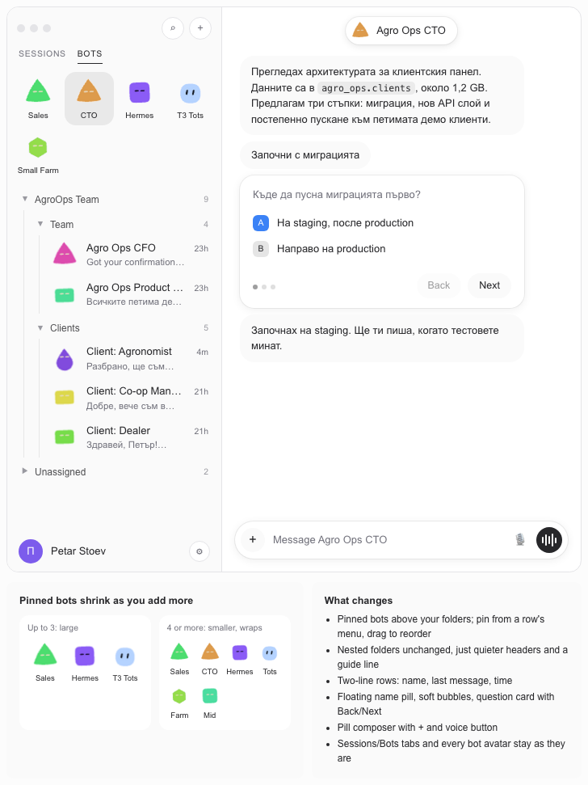
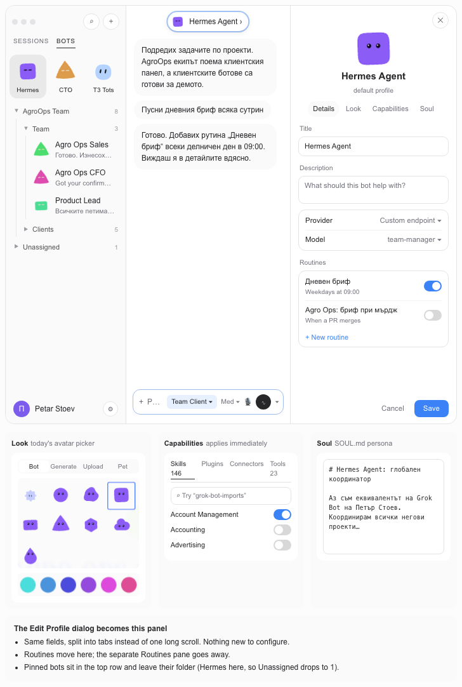

# Plan: Grok-style Bots layout for Hermes Local

Status: **approved design, not started.** Written 2026-11-03 for a later session to execute.
Owner: Petar. Read `CLAUDE.md` (root) and `apps/desktop/AGENTS.md`, `apps/desktop/DESIGN.md`,
`apps/desktop/src/AGENTS.md` before writing code.

## Goal

Make the desktop app's Bots view feel like the Grok Bot app (calm, elegant) while keeping Hermes's
own features: nested folders, avatars, composer, Edit Profile content. Ship it to Petar's
installed **Hermes Local** build; keep the code upstreamable.

## Images

Target designs (follow these):

| Image | What it shows |
|---|---|
|  `img/01-target-sidebar-and-chat.png` | Sidebar with pinned row, nested folders, two-line rows; chat with name pill, soft bubbles, question card. **Ignore its composer** (see decisions). |
|  `img/02-target-details-panel.png` | Details panel opened from the name pill: hero, tabs Details / Look / Capabilities / Soul, routines with switches, Save. The swatch strip in the Look preview is cropped; the real picker has 12 colors. |

References:

| Image | Use it for |
|---|---|
| `img/ref-current-hermes-vs-grok.png` | Left: today's Hermes Bots sidebar. Right: Grok Bot app (the look to match). |
| `img/ref-grok-pinned-bots.png` | Pinned bots as large tiles at the top. |
| `img/ref-grok-name-pill.png` | Floating name pill with avatar and `>`; clicking it opens details. |
| `img/ref-grok-details-panel.png` | Grok's details panel layout (hero, segmented tabs, grouped boxes, switches). |
| `img/ref-hermes-composer-keep.png` | **The Hermes composer to keep unchanged.** |
| `img/ref-hermes-edit-profile*.png` | Today's Edit Profile dialog: its content becomes the panel tabs. |

## Decisions (all confirmed by Petar)

1. **Pinned bots** render as a tile grid above the folders. Up to 3 pins: large tiles (about 48px
   avatars), 3 per row. 4 or more: smaller tiles (about 36px), 4 per row, wrapping onto more rows.
2. **A pinned bot leaves its folder** (shown only in the pinned grid; folder counts drop).
3. **Nested folders stay exactly as built** in `feat/nested-bot-sidebar-folders` (collapse,
   drag-to-nest, reorder). Only restyle: quieter headers, count on the right, thin guide line per
   level.
4. **Two-line bot rows:** name + last-message preview + relative time.
5. **Keep the SESSIONS / BOTS tabs** as they are (legacy, for now).
6. **Never change bot avatars** (shapes, colors, faces). Only their size/position in the layout.
7. **Chat:** floating name pill (avatar + name + `›`) at the top center; restyle message bubbles
   (soft rounded, Grok-like) and the question/clarify card (pager dots, Back/Next).
8. **Composer: keep the Hermes composer as-is** (`img/ref-hermes-composer-keep.png`): `+`,
   placeholder, model chip, reasoning level, mic, voice button, chevron. Do not restyle it.
9. **Details panel** opens from the name pill (click again or `✕` closes). Its tabs are exactly
   today's Edit Profile content, nothing new:
   - **Details:** Title, Description, Provider, Model, **Routines** (list with on/off switches,
     `+ New routine`), Cancel/Save.
   - **Look:** the existing avatar picker (Bot / Generate / Upload / Pet, shapes, colors, Match
     the name).
   - **Capabilities:** the existing Skills / Plugins / Connectors / Tools browser (applies
     immediately, as today).
   - **Soul:** the SOUL.md editor.
   Save semantics stay as today: capabilities apply immediately, the rest on Save.
10. **Retire the separate Routines pane**; routines live only in the Details tab.
11. **Edit Profile dialog is replaced by the panel.** "Edit profile" in a bot row's menu opens the
    panel for that bot. Creating a new bot keeps its own dialog (`create-dialog.tsx`).
12. The panel remembers its last tab across bot switches.
13. **Out of scope:** voice settings (not in Edit Profile today), Grok's Computer/Library tabs.

## Branches

- Build on a new branch **`feat/bots-sidebar-pins`** stacked on `feat/nested-bot-sidebar-folders`
  (do not modify that PR branch). Possibly split into two PRs later: (a) sidebar + pins + pill +
  bubbles, (b) details panel + routines move.
- When done: `git checkout local && git merge feat/bots-sidebar-pins`, rebuild, install (see
  `CLAUDE.md` § Update and rebuild). Never PR from `local`.
- This `plans/` folder exists only on `local`; do not carry it into the feature branch.

## Code map (verified 2026-11-03, re-check before editing)

All under `apps/desktop/src/plugins/hermes-bots/` unless noted.

| Concern | Where |
|---|---|
| Pinned flag (already exists) | `bot-meta.pinned` in `types.ts`; `isBotPinned()` in `hidden-bots.ts:29`; toggle in `bot-row.tsx` (~line 360, row menu); sort band in `roster-pane-derivation.ts` |
| Sidebar roster | `roster-pane.tsx`, `roster-pane-content.tsx`, `roster-pane-sections.tsx`, `roster-sections.tsx`, `roster-pane-toolbar.tsx` |
| Nested folders | `user-sections.ts`, `user-sections-ui.tsx`, `roster-pane-sections.tsx` (from the nested-folders branch) |
| Bot row | `bot-row.tsx`, `row-helpers.ts`, `recent-session.ts` (preview text/time) |
| Avatars (do not change) | `avatar.tsx` (`BotFace`), `avatar-picker.tsx`, `avatar-image.ts` |
| Routines | `cron.tsx` (`RoutinesPane`, `RoutineRow`, `CreateRoutineDialog`, `RoutineDetailDialog`); pane registration in `plugin.tsx` ~lines 499-610 (`registerRoutinesPane`, `syncRoutinesPane`) |
| Edit Profile | `edit-profile-dialog.tsx`, `edit-profile-look.ts`, `profile-config.tsx` (`AdvancedProfileConfig`, `applyAdvancedConfig`), `soul.ts`, `dialog-parts.tsx`; opened from `roster-pane-dialogs.tsx`, `screen-hero.tsx`, `cron.tsx` |
| Chat surface | `apps/desktop/src/app/chat/` (`session-view.tsx`, `route-tile.tsx`); Bot Mode chat parts in `chat-empty.tsx`, `group-chat-*.tsx` |
| Composer (keep) | `apps/desktop/src/app/chat/composer/` |
| Strings | `i18n-messages.ts`, `i18n.ts` (update every locale) |

## Phases

Each phase ends green: `cd apps/desktop && npm test -- <touched area>` (match how the suite is run;
read `package.json` scripts), `python scripts/check` from the repo root, then a visual check in the
dev app (`run` skill or `npm run dev`).

### Phase 1: pinned grid + pinned bots leave folders
1. Derive `pinnedBots` from roster rows with `isBotPinned`; exclude them from folder/section
   derivation (counts too).
2. New `pinned-grid.tsx`: tile grid using `BotFace` at two sizes (≤3 pins large/3 cols, ≥4 small/4
   cols, wraps). Click opens the bot's chat (same action as clicking its row). Selected tile gets
   the row selection background.
3. Drag to reorder pins: persist order in bot meta (add `pinnedOrder` or reuse an existing order
   field; check `group-order.ts` for the existing pattern before adding one).
4. Tests: pinned bot disappears from its folder; grid size switches at 4; order persists.

### Phase 2: sidebar restyle
1. Folder headers: muted label, chevron, count right-aligned, indentation + 1px guide line per
   level. Keep every nested-folder behaviour (collapse, drag-to-nest, reorder) and its tests green.
2. Bot rows: avatar, name, one-line last-message preview, relative time. Reuse the existing
   preview/time source (`recent-session.ts`); do not add a new query.
3. Profile row at the bottom (avatar, name, settings button) if not already present.
4. Tokens only (`--ui-*`), no raw colors; follow DESIGN.md flatness rules.

### Phase 3: chat name pill + bubbles + question card
1. Floating pill at the chat top center: `BotFace` + display name + `›`. It is a button that
   toggles the details panel (Phase 4). Hover/focus states, keyboard accessible.
2. Message bubbles: soft rounded background for bot messages, compact pill for short user
   messages. Restyle via the existing message primitives, not per call site.
3. Clarify/question card: options, pager dots, Back/Next, elevated with `shadow-nous`.
4. **Do not touch the composer.**

### Phase 4: details panel (replaces Edit Profile)
1. New right-side panel component that renders the hero (avatar, title, profile name) and tabs
   Details / Look / Capabilities / Soul. Move the existing Edit Profile sections into tabs; extract
   shared pieces rather than duplicating them.
2. Details tab embeds the routines list (from `cron.tsx`) with switches and `+ New routine`.
3. Rewire every `EditProfileDialog` opener (`roster-pane-dialogs.tsx`, `screen-hero.tsx`,
   `cron.tsx`) to open the panel. Delete the dialog when nothing uses it.
4. Remember last tab (renderer-local store, scoped per window).
5. Never move focus or open the panel on a background event (AGENTS.md "Respect the person").

### Phase 5: retire the Routines pane
1. Remove the pane registration in `plugin.tsx` (`registerRoutinesPane` / `syncRoutinesPane`) and
   any dismissed-pane state it owned. Keep `RoutinesPane`'s data logic if the panel reuses it.
2. Tests: routines still list, toggle, create, open detail from the panel.

### Phase 6: ship to Hermes Local
1. Review (fresh-eyes review per `~/.claude/CLAUDE.md`), `python scripts/check`, desktop tests.
2. Merge into `local`, push, rebuild with `SDKROOT=...MacOSX26.0.sdk scripts/build-bundle.sh`,
   quit Hermes Local, replace `/Applications/Hermes Local.app` (move the old one to `/tmp`),
   relaunch, confirm the stamp commit.
3. Show Petar screenshots of each area before calling it done.

## Acceptance checklist

- [ ] Pinned grid matches `img/01` and the "shrinks as you add more" rule.
- [ ] Pinned bots are absent from folders; counts correct.
- [ ] Nested folders behave exactly as before.
- [ ] Rows show name, preview, time.
- [ ] SESSIONS / BOTS tabs unchanged.
- [ ] Avatars pixel-identical to before.
- [ ] Name pill opens/closes the details panel; matches `img/02`.
- [ ] Panel tabs contain exactly the old Edit Profile content; Save semantics unchanged.
- [ ] Routines only in the Details tab; old pane gone.
- [ ] Composer unchanged (`img/ref-hermes-composer-keep.png`).
- [ ] All locales updated; DESIGN.md checklist passes; no raw colors.
- [ ] Hermes Local rebuilt and installed from the merged `local`.
